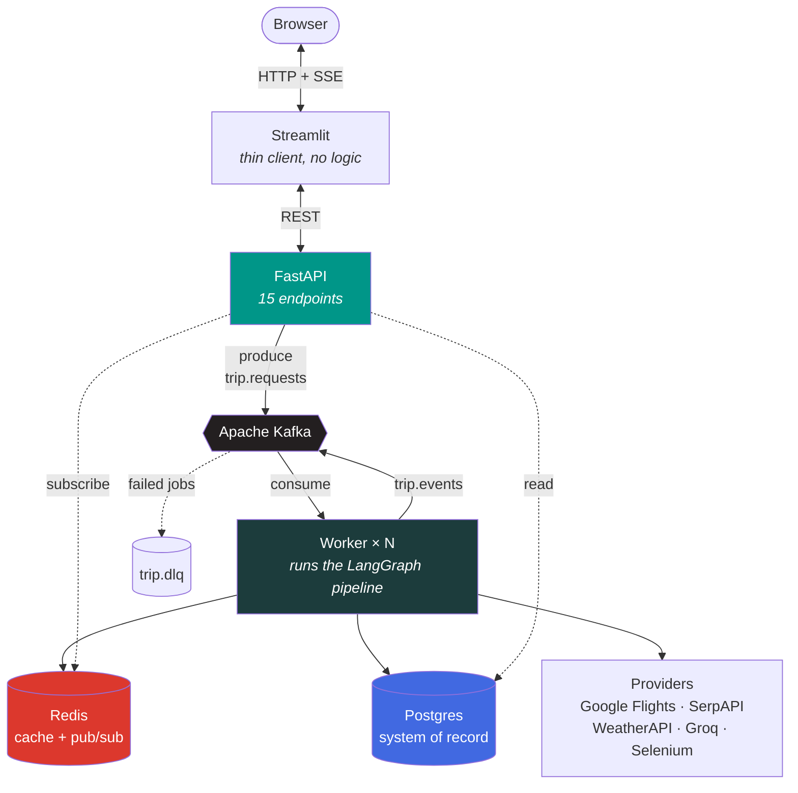
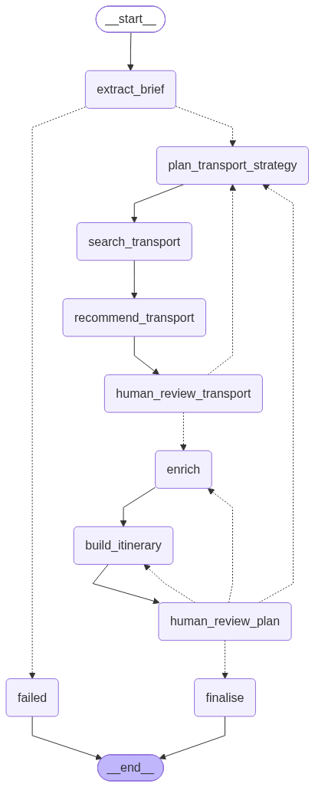
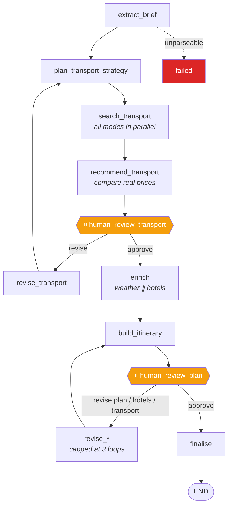

<div align="center">

# ✈️ AI Travel Planner

**Tell it where you want to go. It searches flights, trains, buses and cabs at the same time, stops to ask what you think, and hands back a weather-aware day-by-day itinerary with a cost estimate that comes from real prices.**

[](https://www.python.org/)
[](https://fastapi.tiangolo.com/)
[](https://langchain-ai.github.io/langgraph/)
[](https://kafka.apache.org/)
[](https://redis.io/)
[](https://www.postgresql.org/)
[](https://docs.docker.com/compose/)
[](#-tests)

*Rebuilt from a single 1,200-line Streamlit script into an actual service.*

</div>

---

## What it does

```
"Delhi to Goa, 23rd to 26th August, 2 people, beaches and food"
                              │
                              ▼
   parses it → searches every transport mode in parallel → recommends one
                              │
                        ⏸  asks you
                              │
   weather + hotels → day-by-day plan → ⏸ asks you again → final itinerary
                              │
                              ▼
              ₹90,076 total · ₹45,038 per person · 6/6 providers OK
```

That last line is a real run, not an illustration — see [Proof it works](#-proof-it-works).

---

## 🏗 Architecture



**Why both Redis and Postgres.** Redis is the fast path — cache, pub/sub fan-out, a 24-hour copy of the latest result. Postgres is the durable one. Before it existed a finished plan lived *only* in Redis under a TTL: a cache used as a result store, where one eviction silently destroyed a completed trip and there was no way to list what you planned last week. Now an eviction costs latency, not data.

Putting the LangGraph checkpointer in that same Postgres is what makes `--scale worker=N` real. With SQLite, a trip paused on one worker could only be resumed by *that* worker. Any worker can now resume any trip.

### The graph





`⏸` is a real `interrupt()`. The graph checkpoints and hands control back; the API resumes it with `Command(resume=…)` — possibly **in a different process, hours later**. This was verified by starting a trip in one Python interpreter and resuming it in a freshly launched one.

---

## 🚀 Quick start

The whole stack, one command:

```bash
cp .env.example .env
$EDITOR .env              # add GROQ_API_KEY — the only mandatory value
docker compose up -d      # postgres · kafka · redis · selenium · api · worker×2 · ui
```

→ **UI** http://localhost:8501  ·  **API docs** http://localhost:8000/docs

<details>
<summary><b>Or run the pieces locally</b></summary>

```bash
make install          # venv + deps, copies .env.example -> .env
make infra            # Redis + Kafka + Postgres + headless Chrome (docker)
make migrate          # create the tables (needs DATABASE_URL)
make api              # http://localhost:8000/docs
make worker           # in another terminal
make ui               # http://localhost:8501
make check-db         # diagnose DATABASE_URL: connection, TLS, schema
make graph            # print the mermaid topology
```

</details>

**Nothing is mandatory except `GROQ_API_KEY`.** Every other dependency degrades instead of failing:

| Missing | What happens |
|---|---|
| Redis | cache falls back to an in-process LRU |
| Kafka | the API runs plans in a background task |
| `DATABASE_URL` | no durable history — writes no-op, history endpoints answer 503 |
| any provider key | that provider reports unavailable, the rest of the plan still completes |

With **zero** credentials beyond Groq the graph still reaches a coherent review pause.

### Configuration

| Variable | Needed? | Gains |
|---|---|---|
| `GROQ_API_KEY` | **required** | the LLM behind extraction, routing and itinerary text |
| `DATABASE_URL` | recommended | durable history, shared checkpoints across workers |
| `WEATHER_API_KEY` | optional | weather in the itinerary (weatherapi.com, 14-day horizon) |
| `SERPAPI_KEY` | optional | real hotel prices, and a hotel line in the budget |
| `TAVILY_API_KEY` | optional | live cab fares instead of distance-based estimates |
| `AMADEUS_CLIENT_ID` / `_SECRET` | optional | bookable flight offers — **flights work with no key at all** |

> **Supabase note.** Use the **session pooler** (`aws-0-<region>.pooler.supabase.com:5432`). The direct `db.<ref>.supabase.co` host is IPv6-only, and the transaction pooler on **6543 breaks the LangGraph checkpointer**, which needs session-mode connections. If your password contains `@`, percent-encode it as `%40`.

### API

```bash
# Submit — returns 202 immediately, work happens on a worker
curl -X POST localhost:8000/api/v1/trips -H 'content-type: application/json' -d '{
  "origin": "Delhi", "destination": "Goa",
  "start_date": "2026-09-01", "end_date": "2026-09-04",
  "persons": 2, "preferences": ["beaches", "food"]
}'

curl localhost:8000/api/v1/trips/{id}                 # current state
curl "localhost:8000/api/v1/trips?q=jaipur&limit=10"  # search past trips
curl localhost:8000/api/v1/trips/{id}/providers       # provider-call audit log
curl localhost:8000/api/v1/providers/stats            # success rate + latency
curl -N localhost:8000/api/v1/trips/{id}/stream       # live SSE progress
curl localhost:8000/api/v1/trips/{id}/itinerary       # markdown export
curl localhost:8000/api/v1/trips/{id}/history         # checkpoint audit trail
curl localhost:8000/health                            # deps + circuit breakers

# Answer a human-review interrupt
curl -X POST localhost:8000/api/v1/trips/{id}/resume \
     -H 'content-type: application/json' \
     -d '{"action":"revise_transport","feedback":"prefer an overnight train"}'
```

---

## ✅ Proof it works

Every component below was verified by **running it**, not by reading the code. That habit caught bugs in every single session that review had missed.

| Component | Evidence |
|---|---|
| **Full flow, real browser** | Delhi→Goa, 2 travellers: submit → transport `interrupt()` → approve → plan `interrupt()` → approve → completed. **₹90,076**, 6/6 provider calls OK, 11 checkpoints, all persisted |
| **Interrupt / resume across processes** | started in one interpreter, resumed in a **fresh** one |
| **Redis cache** | identical request: **66 s cold → 5 s warm** |
| **Stale-while-revalidate** | stale entry served in 2 ms, background refresh landed, next call got fresh data |
| **Kafka** | real broker, 3 partitions, consume + **commit with lag 0**; malformed message → `trip.dlq` with raw payload preserved, worker survived |
| **Postgres / Supabase** | PostgreSQL 17.6, migrations applied, drift check clean, full trip persisted |
| **Docker compose** | all 9 services healthy; a trip ran end-to-end inside it via the remote Selenium container |
| **etrain scraper (live)** | Delhi→Jaipur: 19702 SAINIK EXPRESS, 19610 YNRK UDZ EXP … 10 real trains |
| **AbhiBus scraper (live)** | 10 real buses on near-term dates |
| **Google Flights (live, keyless)** | DEL→BOM 58 results in 1.5 s, IndiGo ₹12,174; DEL→GOI 7; BLR→DEL 37 |
| **WeatherAPI (live)** | Jaipur +5 days: Partly Cloudy, 31.1 °C / 25.8 °C, 12 % rain |
| **SerpAPI hotels (live)** | Goa: Majestic Beach Comforts ₹3,155/night → ₹9,464 total |
| **Streamlit UI** | driven through the real widgets, form → plan → review → itinerary |
| Tests | **119 passing**, pyflakes clean, `pip check` clean |

**Honestly not verified:** Amadeus (not needed — flights are keyless); the Kafka 3-attempt requeue branch (the DLQ path *is* proven, but a valid-but-failing job is hard to construct because the graph handles most failures internally); Tavily cab fares (no credential — fares stay labelled as estimates).

---

## 🔧 Design decisions worth explaining

<details>
<summary><b>Flights need no API key at all</b></summary>

Flights use **Google Flights** by default via `fast-flights`, which builds the same Base64 protobuf query the site uses internally and parses the response. No signup, no key, ~1 s per search, real fares.

Amadeus stays available as an optional upgrade and is preferred automatically when credentials exist, because it returns *bookable* offers with fare rules rather than display prices. `FLIGHT_PROVIDER` controls this:

| Value | Behaviour |
|---|---|
| `auto` *(default)* | Amadeus if configured **and** its circuit is closed, else Google Flights. Falls back either way. |
| `google` | Force keyless Google Flights. |
| `amadeus` | Force Amadeus. |

A missing key degrades flight data *quality*, never its availability.

> **On MCP:** every flight MCP server available today wraps Amadeus, Duffel or Kiwi, so it still needs that provider's API key. MCP is a tool-calling protocol for LLM clients, not a data source. The keyless win came from Google Flights, not from MCP.

</details>

<details>
<summary><b>What the caching actually buys</b></summary>

| Namespace | TTL | Why |
|---|---|---|
| `weather` | 1 h | forecasts update hourly at best |
| `flights` | 30 m | fares move, but not every second |
| `hotels` | 6 h | nightly rates are stable intra-day |
| `trains` | 6 h | a timetable barely changes |
| `buses` | 30 m | seat availability moves |
| `wikivoyage` | 7 d | turns a 20–60 s index build into a lookup |
| `geo:iata` | 30 d | airport codes do not change |

Plus **single-flight locking** — 50 simultaneous "Goa hotels" requests collapse to one upstream call — and `skip_cache=True` when a user explicitly asks for different options.

**Stale-while-revalidate.** Past 75 % of its TTL an entry is still served immediately while a refresh runs in the background, so a regularly-queried route is never the one paying for a 30-second scrape. One refresh lock means N concurrent readers trigger one re-scrape, not N.

**Three grades of "nothing found"**, because they are not the same thing:

| Result | Cached for | Why |
|---|---|---|
| real data | full TTL | the answer is good |
| empty, no explanation | 5 min | probably a broken selector or a blip — retry soon |
| explicit "no service on this route/date" | 1 hour | the provider looked and answered; re-asking costs another 30 s scrape to hear the same thing |

That distinction is worth real time: AbhiBus takes ~30 s to answer and bus operators only publish schedules about a month ahead, so far-future searches are reliably empty. Measured on one Delhi→Jaipur request: **66 s cold, 5 s warm.**

</details>

<details>
<summary><b>What the database stores</b></summary>

Four tables, migrated with Alembic (`make migrate`).

| Table | Holds | Why it is not just JSON in Redis |
|---|---|---|
| `trips` | one row per request, from 202 to final state | the system of record; survives eviction, restart and redeploy |
| `itineraries` | the plan, **versioned per revision** | "show me what you proposed before I asked for cheaper" is a query, not a lost message |
| `provider_calls` | every outbound call: latency, ok, cache hit, result count | turns "the scrapers are flaky" into a number you can set breaker thresholds from |
| `cost_snapshots` | the budget per revision, `Numeric(12,2)` | money; the original did float arithmetic on strings parsed from `"₹5,000"` |

The trip row is written **before** the job is handed to Kafka, so a request is never lost in the window between the 202 and a worker picking it up.

`provider_calls` fills itself: the `@resilient` decorator that already wraps every provider call records the outcome, and a `contextvars` context carries the trip id down into concurrent fan-out — so no provider signature grew a `trip_id` parameter just for bookkeeping.

Persistence is **best-effort on writes, honest on reads**: a database blip must not fail a planning run, but a user asking for their history gets a 503 rather than a silently empty list.

</details>

<details>
<summary><b>Where Kafka earns its place</b></summary>

* `trip.requests` — the work queue. The API returns in milliseconds instead of holding a connection open for 60–120 s. Partitioned by `trip_id`, so one trip's work stays ordered on one consumer and scaling is just `--scale worker=N`.
* `trip.events` — durable event log; powers the live feed and doubles as an audit trail of which node failed and how long each provider took.
* `trip.dlq` — jobs that exhausted their retries, kept for inspection.

Delivery is at-least-once: offsets commit only after a run finishes. That is safe here because the checkpointer makes a replay *resume* rather than redo, and the cache absorbs repeated provider calls.

</details>

---

## 🔍 Issues found in the original code

The original was a working demo with **45 real defects** — several of which meant advertised features could not function at all. All are catalogued below; the ones marked **fixed & tested** have a regression test in `tests/`.

> The original sources are preserved verbatim in [`legacy/`](legacy/) so the before/after is inspectable.

**The five worst:**

| # | Issue | Why it mattered |
|---|---|---|
| 1 | **`llm` was never defined** | `NameError` in three nodes — including the *default fallback route*, so the most common path always failed silently |
| 2 | **Human review did nothing, ever** | `st.button` inside a graph node returns `False` on first render, so the approval edge always defaulted to "approved". The feature could not work by construction |
| 4 | **Messages grew quadratically** | nodes returned `[*state["messages"], new]` into an `add_messages` reducer, which *appends* — by node six the transcript held hundreds of duplicates, all re-sent to the LLM |
| 21 | **The checkpointer was decorative** | a fresh `MemorySaver()` per call plus a new `uuid4()` thread_id per invocation ⇒ nothing was ever resumed. This is also *why* human-in-the-loop could not work |
| 39 | **Four live API keys committed to a public repo** | WeatherAPI, SerpAPI, Amadeus id+secret, Groq — all hardcoded in source |

<details>
<summary><b>🔴 Crashes and silent wrong answers (1–11)</b></summary>

| # | Issue | Detail |
|---|---|---|
| 1 | **`llm` was never defined in `mainpy.py`** | Line 40-41 defined it, then commented it out. `multi_leg_train`, `train_partial_road` and `bus_or_cab_only` all call `llm.invoke(...)` → `NameError`. Each was wrapped in a bare `except`, so it surfaced as the string `"❌ Bus/Cab Only Tool failed: name 'llm' is not defined"` — *and `bus_or_cab_only` was the default fallback route*, so the most common path always failed silently. |
| 2 | **Human review did nothing, ever** | `human_node` rendered `st.button` **inside a graph node during `graph.invoke()`**. `st.button` returns `False` on first render, so `human_review_result` was never set; `human_review_condition` took its `"approved"` default on every run. Streamlit also reruns the whole script on interaction, by which point the invocation has finished. **Fixed & tested** — now `interrupt()`. |
| 3 | **`input()` inside a graph node** | `llm_feedback_router` called `input("Would you like to customize the plan?")`. In Streamlit that blocks the server thread; in a worker it raises `EOFError`. **Fixed & tested.** |
| 4 | **Message list grew quadratically** | Nodes returned `[*state["messages"], AIMessage(...)]` into an `add_messages` reducer, which *appends* what you return — so every node re-appended the entire history. By the sixth node the transcript held hundreds of duplicates, all sent to the LLM on each call. The single most expensive bug in the project. **Fixed & tested.** |
| 5 | **Every hotel price read "N/A"** | `float("₹5,000")` raises `ValueError`; the bare `except` swallowed it and set `total_price = "N/A"` for *every* hotel, on every search. **Fixed & tested** (9 parsing cases). |
| 6 | **`persons` landed in the `time` parameter** | `find_cabs(origin, destination, date=None, time=None, persons=1)` but every call site passed `find_cabs(o, d, date, parsed["Persons"])`. The passenger count went into `time`; `persons` was always 1. **Fixed & tested.** |
| 7 | **Error payloads rendered as flight results** | `search_flights_tool` returned `{"error": ...}` on failure; the caller did `if not flights: raise`. A non-empty dict is truthy, so the error dict flowed on as if it were data. **Fixed.** |
| 8 | **`UnboundLocalError` in `bus_or_cab_only`** | `bus_error` was only assigned inside `except`. When the bus search *succeeded but returned nothing*, `has_direct_bus` was `False` and line 748 referenced the unbound `bus_error`. |
| 9 | **Bus times were shifted between rows** | `times[::2]` / `times[1::2]` sliced one flat list of every `<span>` on the page. Any row rendering a third span ("Live Tracking", "Rest Stop" badges — common) shifted every subsequent row's departure/arrival by one. Silently wrong data, no error. **Fixed** (per-card parsing). |
| 10 | **Unvalidated LLM strings used as graph edges** | `route_from_llm_decision` returned raw LLM content straight into `add_conditional_edges`. `"Hotels."`, `"end"`, or a full sentence → no matching key → runtime error. **Fixed & tested** (5 garbage-input cases). |
| 11 | **`int(parsed["Persons"])` with no validation** | `Persons` came from an LLM and could be `None` (`TypeError`) or `"2 people"` (`ValueError`), inside a node, mid-plan. **Fixed** — validated once at the edge. |

</details>

<details>
<summary><b>🟠 Resource leaks and reliability (12–20)</b></summary>

| # | Issue | Detail |
|---|---|---|
| 12 | **Selenium driver never quit** | `train_data.get_etrain_trains` has no `try/finally` and no `driver.quit()` on the success path or on most error paths. Every train lookup leaked a Chrome process and its profile dir. A handful of requests exhausted memory. **Fixed** — context manager guarantees teardown. |
| 13 | **Browsers launched visibly, maximised** | `--start-maximized`, no `--headless`. Impossible on a server; steals focus on a laptop. **Fixed.** |
| 14 | **No timeouts anywhere** | `requests.get` to SerpAPI had no timeout; Selenium had no page-load timeout. One hung upstream blocked a worker indefinitely. **Fixed** — timeouts on every call. |
| 15 | **No retries, no circuit breaker** | Every failure was final and every request re-hammered a known-dead upstream. **Fixed & tested** — backoff + breaker that opens after N failures. |
| 16 | **Brittle single-selector scraping** | e.g. `//div[@class="row seat-info bd-success-400 text-success-600 bg-success-50"]` — six exact utility classes. One Tailwind rename → silently zero results. **Fixed** — ordered selector fallbacks. |
| 17 | **AbhiBus URL built by string surgery** | Typed into an autocomplete, pressed DOWN+ENTER, then rebuilt the URL via `url.split("/")[-2]`. Any redirect change produced garbage. **Fixed** — deterministic search URL. |
| 18 | **`sleep()` instead of waits** | `sleep(5)`, `sleep(3)`, `sleep(0.5)` in a 12-iteration calendar-clicking loop. Simultaneously too slow and too flaky. **Fixed** — explicit conditions. |
| 19 | **Everything sequential and blocking** | Legs ran one after another inside a sync graph. One 40 s scrape stalled the whole process. **Fixed** — concurrent fan-out; wall-clock is now the slowest single provider, not the sum. |
| 20 | **One dead provider killed the whole plan** | **Fixed & tested** — failures are isolated per provider and reported in `provider_health`. |

</details>

<details>
<summary><b>🟡 Checkpointing and state (21–24)</b></summary>

| # | Issue | Detail |
|---|---|---|
| 21 | **The checkpointer was decorative** | `MemorySaver()` was created *inside* `build_trip_graph()`; Streamlit called that on every rerun; and `plan_my_trip` generated a **fresh `uuid4()` thread_id per invocation**. So it was a brand-new empty store, in a process that restarts constantly, keyed by an ID never reused. Nothing was ever resumed or persisted — which is also *why* human-in-the-loop could not work. **Fixed & tested** — one process-wide durable checkpointer, `thread_id == trip_id`. |
| 22 | **No reducers on any state field** | Only `messages` had one. Nodes returned `{**state, ...}`, fighting the reducers and clobbering concurrent updates. **Fixed** — explicit merge policy per field. |
| 23 | **Unbounded revision loops** | `Human_Review → llm_decider → … → Human_Review` and `User_Feedback → DayWise_Plan` had no cap. A stubborn LLM span until the recursion limit blew up mid-plan. **Fixed & tested** — capped at 3. |
| 24 | **No way to inspect what happened** | **Fixed** — `GET /trips/{id}/history` exposes the checkpoint trail. |

</details>

<details>
<summary><b>🟡 Correctness of the domain logic (25–38)</b></summary>

| # | Issue | Detail |
|---|---|---|
| 25 | **14 weather API calls to fetch 14 days** | The loop called `forecast.json` once *per day*; the API returns the whole range in one call with `days=N`. 14× the cost and latency for identical data. **Fixed.** |
| 26 | **`history.json` used for past dates** | A paid endpoint. On the free tier it errors, and the error text was rendered to users as the forecast. **Fixed** — out-of-horizon days are labelled as such. |
| 27 | **IATA codes invented by an LLM** | `trip_extractor` asked the LLM to produce airport codes in the same call that parsed dates. Hallucinated codes silently search flights between the wrong cities — while `full_iata_codes.csv` sat unused in the repo. **Fixed & tested** — dataset first, LLM only as a validated fallback. |
| 28 | **The LLM chose one transport mode blind** | It committed to a single mode *before any data existed*, and only that mode was searched. Guess "bus_or_cab_only" for Delhi→Chennai and the user never saw a flight. **Fixed** — search all feasible modes, then recommend from real prices and timings. |
| 29 | **`returnDate` always sent to Amadeus** | Forced a round trip on every query, returning nothing for many one-way routes. **Fixed.** |
| 30 | **Chroma index rebuilt on every request** | `daywise_plan` re-fetched two WikiVoyage URLs, re-split, loaded a SentenceTransformer into memory and re-embedded every chunk — 20-60 s and hundreds of MB, per plan, for a corpus that changes monthly. **Fixed** — page cached 7 days; retrieval optional. |
| 31 | **Nightly rate × nights labelled "for N persons"** | Neither a per-person nor a per-night figure. **Fixed & tested** — both reported explicitly. |
| 32 | **No date sanity checks** | End before start, or dates in the past, flowed straight into paid API calls. **Fixed & tested** (8 rejection cases). |
| 33 | **The budget table was fiction** | `app.py` hardcoded `"Flights: 10,000 / Hotels: 36,000 / … Total ₹76,000"` regardless of the actual trip. **Fixed** — computed from real transport + hotel + on-ground figures, with missing components declared. |
| 34 | **The PDF download was a joke string** | `data="This would be the PDF content in a real app"`. **Fixed** — real markdown export endpoint. |
| 35 | **Station file name case-broken on Linux** | `pd.read_excel('Station_name_8477.xlsx')` vs the actual `Station_Name_8477.xlsx`. Works on macOS (case-insensitive), fails on Linux/Docker — *at module import time*, taking the whole module down. **Fixed.** |
| 36 | **414 KB Excel loaded at import time** | Module-level `pd.read_excel` made importing cost seconds. **Fixed** — lazy + cached. |
| 37 | **Unicode hyphens broke station URLs** | The dataset uses U+2010 (`DELHI‐SARAI ROHILLA`), not ASCII `-`. Slug building produced broken URLs. **Fixed & tested.** |
| 38 | **Only the top station was tried** | If Delhi's first station had no direct service to the destination, the answer was "no trains" even when a sibling terminal had plenty. **Fixed** — tries the top station pairs. |

</details>

<details>
<summary><b>🔴 Security and hygiene (39–45)</b></summary>

| # | Issue | Detail |
|---|---|---|
| 39 | **Four live API keys committed to a public repo** | WeatherAPI (`mainpy.py:58`), SerpAPI (`hotels_data.py:3`), Amadeus id + secret (`airplane_data.py:7-10`), Groq (`daywise_plan.py:45`). **Fixed** — all moved to env, and the values in `legacy/` are now redacted placeholders. **⚠️ Rotate every one of them anyway; git history still contains them.** |
| 40 | **`.env` committed** (and `__pycache__`, and two Windows `.exe` files in `output/`) | No `.gitignore` existed. **Fixed** — `.gitignore` added, junk untracked. ⚠️ A later pass found `.env` was *still tracked*: gitignore does not untrack files git already knows about, so the ignore rule was silently inert and any `git add -A` would have re-committed it. Now `git rm --cached`'d, with a regression test (`tests/test_repo_hygiene.py`). |
| 41 | **No `requirements.txt`** | The project could not be installed by anyone. **Fixed.** |
| 42 | **`allow_origins=["*"]`** | Fine locally; tighten before deploying (noted in code). |
| 43 | **Business logic coupled to Streamlit** | `st.subheader`/`st.markdown`/`st.write` called from inside graph nodes, and `import streamlit` at the *bottom* of `mainpy.py` (line 1239) after the functions that use it. Unusable in any non-Streamlit context. **Fixed** — nodes are UI-free. |
| 44 | **`print()` as the only diagnostics** | Invisible in a worker, unfilterable in production. **Fixed** — structured logging. |
| 45 | **Duplicated `State` definition** | Defined identically in both `app.py` and `mainpy.py`; both files also created an unused module-level `graph_builder`. **Fixed.** |

</details>

---

## 🧪 Tests

```bash
make test        # 119 tests (7 database tests skip without a database)
make test-db     # all 119, including the Postgres integration tests
```

Covering: interrupt/resume across a rebuilt graph object, revision-loop termination, message non-duplication, router robustness against garbage LLM output, price parsing, cab signature, geo resolution, unicode station names, date validation, cache hit/miss/skip semantics, circuit-breaker opening, provider-failure isolation, the full API contract, connection-URL normalisation (Supabase pooler and `sslmode`), persistence round-trips, revision retention, idempotent replay, the fail-fast status regression, the checkpointer setup race, and the in-flight status regression.

`make test` never touches a real database. `tests/conftest.py` forces `DATABASE_URL=""` because the suite previously inherited whatever was in `.env` and wrote trips into it — which would have been Supabase or production just as readily as a local scratch database.

---

## 📁 Layout

```
app/
  api/         FastAPI app, routes, schemas
  core/        cache (Redis), bus (Kafka), events, resilience, context
  db/          models, session, repository (SQLAlchemy async)
  graph/       state, nodes, routers, builder, checkpointer
  providers/   weather, flights, trains, buses, cabs, hotels, itinerary,
               extractor, geo, llm
  scraping/    Selenium lifecycle
  services/    planner (drives the graph)
  workers/     Kafka consumer
ui/            Streamlit client (HTTP only)
alembic/       database migrations
tests/         graph flow, providers, API, persistence
legacy/        the original v1 files, for reference
```

---

## ⚠️ Security

**The four API keys listed in issue #39 are present in this repository's git history and must be rotated.** They have been removed from the working tree and replaced with placeholders in `legacy/`, but rewriting history does not un-leak a key that was public — rotation at the provider is the only fix. The same applies to any database password.

`.env` is untracked and `tests/test_repo_hygiene.py` fails the build if any secret file becomes tracked again.

## Known limitations

* Scrapers depend on third-party markup and will need selector maintenance; failures degrade to "unavailable" rather than breaking the plan.
* Cab fares are distance-based estimates, not live quotes, unless `TAVILY_API_KEY` is set. Labelled as estimates in the output.
* Amadeus `test` hostname returns limited inventory; set `AMADEUS_HOSTNAME=production` with production credentials for real fares.
* SQLite checkpointing is single-node. Set `CHECKPOINTER_BACKEND=postgres` (with `DATABASE_URL`) so every worker shares one checkpoint store; Redis is also supported via `langgraph-checkpoint-redis`.
* The Postgres checkpointer needs **session-mode** connections. Supabase's transaction pooler (port 6543) works for the application but not for the checkpointer — use the session pooler (5432), or keep the checkpointer on SQLite.
* `allow_origins=["*"]` is set for local development and should be tightened before any real deployment.
